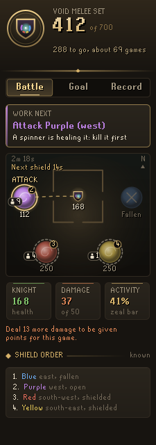
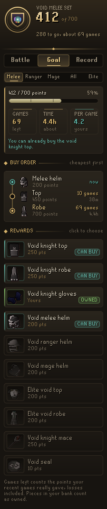
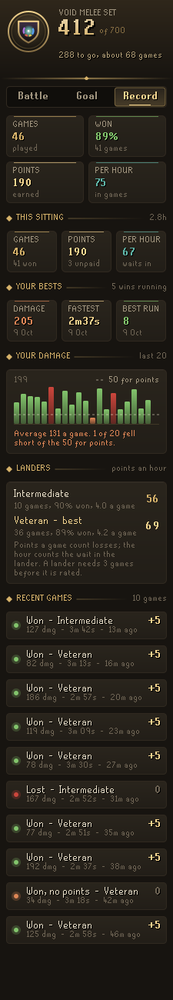
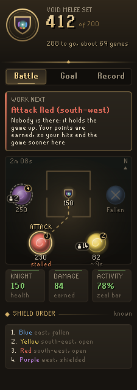
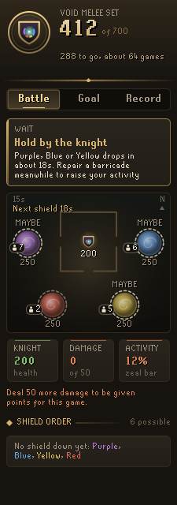
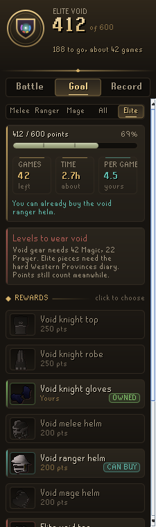
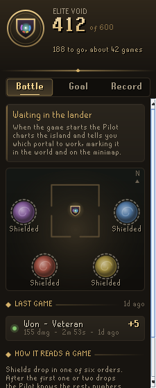
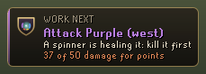
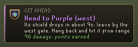
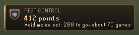

# Codex Pest Control Pilot

**Which portal to work next, and how many games until your void.** In every Pest Control game the Pilot reads the shield order as it unfolds, tells you which portal to work, marks it in the world and on the minimap, and keeps a running count of your damage so you never miss out on points. Outside the game it counts your commendation points toward the void pieces you choose and how many games that takes.

It is part of the **Codex** suite, alongside [Codex Navigator](https://github.com/Nubles/OSRS-Codex-Navigator), [Codex Guardian](https://github.com/Nubles/OSRS-Codex-Guardian), [Codex Gear Roadmap](https://github.com/Nubles/OSRS-Codex-Gear-Roadmap), [Codex Session Chronicle](https://github.com/Nubles/OSRS-Codex-Session-Chronicle), [Codex Ledger](https://github.com/Nubles/OSRS-Codex-Ledger) and [Codex Quartermaster](https://github.com/Nubles/OSRS-Codex-Quartermaster), and shares their look: warm ink, aged gold and the game's own fonts.

Guidance only: the Pilot never clicks, moves or attacks for you.

<p align="center">
  
  
  
</p>

## What it does

- **Work next.** One line that says what to do now. When a shield is down: attack that portal, the weakest one if several are open unless another is a good deal nearer, and kill the spinners first when they are healing it (from range if you fight with a bow or staff) or clear the brawlers in a melee fighter's way. When no shield is down but the order is known: head for the portal whose shield drops next, and which gate to leave by. Before that: hold by the knight, with the portals that could drop next. When the Void Knight is low and nothing is open: defend him.
- **The island, charted.** The Battle tab draws the outpost with its west, east and south gates and the four portals where they stand. Open portals glow, shielded ones sit behind a pale ring, fallen ones go grey, each shows its health, and they are numbered in the order their shields drop. The one to work wears a gold halo, with the way there traced from the knight through the right gate.
- **Reading the team.** Players are counted at every portal. Until you have your points, the Pilot sends you to the open portal with far fewer players, where your hits land instead of being shared out among a crowd.
- **The portal holding the game up.** Each open portal's health is watched over ten seconds and, with your own hits left out, turned into how long the rest of the team will take to bring it down. Once your 50 damage is in, the game ends only when the last portal falls, so the Pilot sends you to the open portal falling last, or not at all because nobody is there. It holds that choice while the gap is small, so it does not flicker between two portals. The chart shows each portal's pace, "stalled", or "just you" when only your hits are bringing it down.
- **Shield countdown.** The Pilot learns from your own games how long each shield takes to drop and counts down to the next one, so you are standing at the portal when it opens.
- **Activity.** The game's own activity bar is read alongside your damage, and while you wait for a shield with a low bar the Pilot suggests repairing a barricade.
- **Reading the rotation.** Shields always drop in one of six orders. After the first one or two drops the Pilot knows the rest of the game and sends you ahead of the crowd.
- **Marked in the world.** The portal to work gets an outline in its colour, a gilt ring on its tile, a word over it and a ring on the minimap. While the next drop is still open, every candidate gets a faint outline.
- **Void check.** Before a game, at the outpost or in the lander, the Battle page says what the void you wear does for the weapon in your hand: *Elite void on, ranged set bonus for this game*. When it gives nothing, the plaque says so while there is still time to fix it: a piece missing (*No gloves on, so no set bonus at all. You own the rest*), or a helm for another style (*Mage helm on a ranged weapon: swap to your ranger helm for the set bonus*). It can be turned off.
- **A dropped connection.** If the client loses its connection mid-game and gets it back, the Pilot carries on with the same game and your damage so far, rather than starting the count again from nothing.
- **Damage for points.** A game only gives points once you have dealt 50 damage. The plaque and the panel count yours, so you know when you have done enough.
- **Goal.** Pick the void melee, ranger or mage set, all three helms, elite void, or any pieces you like (the mace and seal too). The Pilot counts your points against what is left, skipping pieces already in your bank or inventory (or, until you open yours, in the bank [Codex Bank Steward](https://github.com/Nubles/OSRS-Codex-Bank-Steward) last saved, which holds everything down to your void seals, else the gear [Codex Gear Roadmap](https://github.com/Nubles/OSRS-Codex-Gear-Roadmap) saved), and says how many games and how long that is. Points per game and minutes per game are measured from your own games, losses included, once three are in. It flags the combat levels void needs and the hard Western Provinces diary elite needs, and says in the chat box when your points first cover a piece.
- **Buy order.** The pieces still to get, in the order to buy them: the dearest piece your points already cover first (the one the Pilot says you can buy now), then the cheapest, with diary-locked elite pieces last, each with the games and time until you can buy it.
- **Landers.** Each lander you have played, rated from your own games: how often you win, the points a game with losses counted, and the points an hour with the wait in the lander counted. When another lander you can board pays clearly better, the Goal page says so.
- **Sittings and game summaries.** The Record page shows the sitting in hand (games back to back with no break over fifteen minutes): games, wins, points, games won without the damage for points, and points an hour with the lander time between games counted, which the record's "in games" rate leaves out. After each game a line in the chat box gives its points and damage, the points still to your goal and the games that takes, and the sitting so far. It warns when you are within 50 points of the 4,000 the knights will hold.
- **Spare points.** Once your goal is bought, or your points cover it with some left, the Goal page shows what the points over it buy as combat experience at the reward shop in every skill at your levels, most first, spent 100 at a time for the shop's 10% bonus. Skills below 25 are shown as locked.
- **When it is yours.** From your sittings over the last four weeks the Pilot learns how much you play here and turns the games left into a date: *about 29 Oct at your pace*. It needs two sittings, and spreads a first busy weekend over a week so it does not read as playing every day.
- **For your goals.** With [Codex Navigator](https://github.com/Nubles/OSRS-Codex-Navigator) goals pinned, the Goal page lists every unfinished goal that needs more Attack, Strength, Defence, Hitpoints, Ranged, Magic or Prayer, with the points that buy the level at the reward shop (each purchase priced at the level it is made at, in the biggest bundles that fit), the games that takes and when: *Ardougne Hard, Magic 66: 311 points, 143 games, 2 Dec*. Points your goal leaves spare count first, and while the goal is still short its own points are earned first, so the games count both. It only reads what Navigator saves and shows nothing without it.
- **Your damage.** A bar for each recent game against the 50 damage a game needs for points, so games that gave nothing stand out.
- **Record.** Games played, how many were won, points earned, points per hour in games and your recent games with their damage, length and points.
- **Plaque.** A gilt plaque in the game view with what to work next and your damage. At the outpost and in the lander it shows your points toward the goal instead.

<p align="center">
  
  
  
  
</p>

<p align="center">
  
  
  
</p>

## How it reads a game

The game's own status bar gives each portal's health, the knight's and your activity. Shields are read from the portals themselves and from the "portal shield has dropped" messages, and each drop rules out the rotations that do not start that way. Your damage is the sum of your own hitsplats on anything in the game. Your style comes from the weapon you hold, and the crowd at a portal is the other players within ten tiles of it. Your points are read from the lander when you board one and from the message at the end of each game.

Everything is kept per account in RuneLite's profile settings, nothing leaves your computer.

## Settings

| Setting | What it does |
| --- | --- |
| Pilot plaque | Show the plaque in games only, at the outpost too (the default), or never |
| Mark the portal | Outline the portal to work in the world and on the minimap |
| Mark possible next portals | Faintly outline every portal that could drop next while none is down |
| Defend knight below | The knight's health at which defending him comes first (60, 0 turns it off) |
| Lander for estimates | Which lander the games-left estimate assumes until your games are measured |
| Announce affordable rewards | Say in the chat box when your points first cover a piece of your goal |

## Building

```
./gradlew build
```

Run it in a development client with `./gradlew run`.

## Licence

BSD 2-Clause, see [LICENSE](LICENSE).
