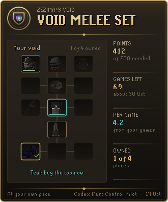

# Codex Pest Control Pilot

**Which portal to work next, and how many games until your void.**

In every Pest Control game the Pilot follows the shield order as it unfolds, says which portal to work, marks it in the world and on the minimap, and counts your damage so you never miss out on points. Outside the game it counts your commendation points toward the void pieces you choose, the games that takes, and when that lands at your pace.

Part of the **Codex** suite of RuneLite plugins. They share one look: warm ink, aged gold and the game's own fonts.

<p align="center">
  
  
  
</p>

## What it does

**Work next.** One line that says what to do now. With a shield down: attack that portal, the weakest if several are open unless another is much nearer, and kill the spinners first when they are healing it. With no shield down but the order known: head for the portal whose shield drops next, and by which gate. Before that: wait by the knight. When the Void Knight is low and nothing is open: defend him.

**The island, charted.** The Battle page draws the outpost with its gates and the four portals. Open portals glow, shielded ones sit behind a ring, fallen ones go grey, each with its health and its place in the shield order. The one to work wears a gold halo, with the way there traced from the knight.

**Reading the game.** Shields always drop in one of six orders, so after the first drop or two the Pilot knows the rest and sends you ahead of the crowd. It counts the players at each portal, and until you have your points it sends you where your hits are not shared out among a crowd. Once your 50 damage is in, the game ends only when the last portal falls, so it sends you to the portal falling slowest. It learns how long each shield takes from your own games and counts down to the next.

<p align="center">
  
  
</p>

**Marked in the world.** The portal to work gets an outline in its colour, a ring on its tile, a word over it and a ring on the minimap. While the next drop is still open, every portal it could be is faintly outlined.

**Damage for points.** A game only gives points once you have dealt 50 damage. The plaque and the panel count yours. If the client drops its connection mid-game and gets it back, the count carries on.

**Void check.** Before a game, at the outpost or in the lander, the Battle page says what the void you wear does for the weapon in your hand. When it gives no set bonus (a piece missing, or a helm for another style), the plaque says so while there is still time to fix it.

**Goal.** Pick the void melee, ranger or mage set, all three helms, elite void, or any pieces you like, the mace and seal too. The Pilot counts your points against what is left, skipping pieces you already own, and says how many games and how long that is. Points and minutes a game are measured from your own games, losses included, once three are in. Before your points are read in a lander, the games show as "?", not counted from zero.

**What your points buy now.** The Goal page draws your void on the equipment screen, owned pieces ticked. Teal lights the pieces your points buy together, choosing the set that spends the most of them: 400 points toward a top and two helms light both helms, not the top with 150 left over. The **Buy order** lists the rest cheapest first, each with the games and time until you can buy it. Elite pieces wait at the end until the hard Western Provinces diary is done.

**Void card.** *Copy void card* puts a picture on your clipboard to paste into a chat: your void as worn beside your points, the games left and when, your points a game and the pieces owned.

<p align="center">
  
</p>

**Record.** Games played and won, points earned and an hour, your damage in each recent game against the 50 it needs, the sitting in hand, and each lander rated from your own games. When another lander you can board pays clearly better, the Goal page says so.

**Spare points.** Once your goal is covered, the Goal page shows what the points over it buy as combat experience at the reward shop, spent 100 at a time for the 10% bonus.

**Chat.** After each game, a line with its points and damage, the points still to your goal and the sitting so far. A line says when your points first buy a piece, and a warning comes within 50 points of the 4,000 the knights will hold.

**Plaque.** In a game, what to work next and your damage. At the outpost and in the lander, your points toward the goal.

<p align="center">
  
  
</p>

## Settings that matter

- **Pilot plaque** (Games and outpost): the plaque in games only, at the outpost and in the lander too, or never.
- **Mark the portal** and **Mark possible next portals** (both on): the outlines in the world and on the minimap.
- **Defend knight below** (60): the knight's health at which defending him comes first; 0 turns it off.
- **Void check on the plaque** (on): the warning when the void you wear gives no set bonus.
- **Game summary in chat** and **Affordable pieces in chat** (both on).
- **Lander for estimates** (Best for my level): which lander the games left assume until your own games are measured.
- **Name on cards** (on): turn off to share the void card without your character's name.

## With other Codex plugins

The Pilot works on its own. With other Codex plugins installed, it reads what they save and never changes it:

- **[Codex Bank Steward](https://github.com/Nubles/OSRS-Codex-Bank-Steward):** until you open your own bank, the bank it last saved tells the Pilot which void pieces you own, down to your seals.
- **[Codex Gear Roadmap](https://github.com/Nubles/OSRS-Codex-Gear-Roadmap):** without Bank Steward, the gear it saved does the same.
- **[Codex Navigator](https://github.com/Nubles/OSRS-Codex-Navigator):** every unfinished goal that needs more Attack, Strength, Defence, Hitpoints, Ranged, Magic or Prayer is listed on the Goal page, with the points that buy the level at the reward shop, the games that takes and when.

## How it reads a game

The game's own status bar gives each portal's health, the knight's and your activity. Shields are read from the portals and from the "portal shield has dropped" messages. Your damage is the sum of your own hitsplats in the game. Your style comes from the weapon you hold. Your points are read from the lander when you board one and from the message at the end of each game.

Everything is kept per account in your RuneLite profile. A save damaged on disk keeps all it can: one unreadable game or setting is lost alone. Before a damaged save, or one a newer version wrote, is first saved over, a copy of it as found is kept aside in your profile.

## Rules posture

Codex Pest Control Pilot only reads what the game already shows you: the portals, the knight, the status bar, your hitsplats, your gear, pack and bank, and the chat messages the game sends. It outlines objects and draws its own panel and plaque. It does not click, move, attack, change menus, or send anything over the network; you do every click.

## Development

```bash
./gradlew build   # compile and run tests
./gradlew run     # launch RuneLite with the plugin loaded
```

The game reading, rotations and goal counting (`core/`) are plain Java with unit tests. The panel and overlays are in `ui/` and `overlay/`.

## Licence

BSD 2-Clause, see [LICENSE](LICENSE).
